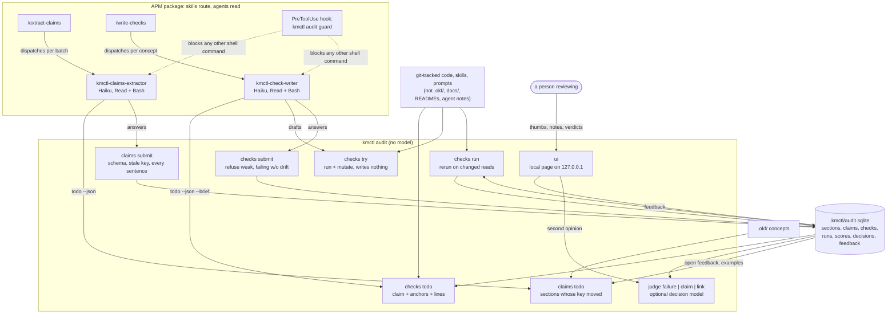

# The audit pipeline

`kmctl audit` checks what the `.okf/` bundle says against the code. kmctl
calls no model for it except the optional `kmctl audit judge`: two Haiku
subagents, driven by two skills, do the reading and writing, and kmctl
hands out the work, validates and measures what comes back, stores it and
reruns it. The choices are in
[ADR 0036](../decisions/0036-claims-are-extracted-by-the-agent-through-kmctl-audit-claims.md),
[ADR 0037](../decisions/0037-the-claims-and-checks-agents-get-a-plain-shell-and-i2-narrows.md),
[ADR 0038](../decisions/0038-checks-are-step-data-that-kmctl-reruns-and-only-checks-that-notice-a-change-are-stored.md),
[ADR 0039](../decisions/0039-kmctl-audit-judge-asks-an-optional-decision-model-off-by-default.md)
[ADR 0040](../decisions/0040-the-audit-pipeline-holds-its-agents-by-a-hook-and-keeps-answers-through-rewording.md)
and [ADR 0041](../decisions/0041-people-review-claims-and-checks-on-a-local-page-and-their-feedback-goes-back-to-the-agents.md);
[the overview](overview.md) places it among kmctl's other parts.

## The flow

1. **Sections.** `kmctl audit claims todo` cuts each live concept at its
   `#` to `###` headers into numbered sentences. A section's key hashes its
   text, its concept's id, title, status and type, the sections before it
   and the extraction instructions; only sections whose key moved are
   handed out.
2. **Claims.** The extractor gives every sentence a verdict (kind,
   quantifier, standalone claims) and pipes them to `kmctl audit claims
   submit`, which refuses a stale key, a missing or doubled sentence and a
   malformed answer, one stderr line each. A claim's id hashes its concept
   and text.
3. **Lines.** `kmctl audit checks todo` hands out the point, structural and
   broad claims with no answer, each with its anchors (every backticked
   span resolved to a path, command, flag or name) and the lines around
   them, or keyword windows from the concept's `sources`.
4. **Checks.** The check writer drafts steps from a fixed DSL and runs them
   with `try`, which also changes the matched lines in memory (flip a
   boolean, change a number, string or YAML value, rename a definition or
   YAML key, negate a condition, delete a statement). `submit` stores a
   check only when it notices some of those changes, a failing check only
   with `drift`, and a reason when no step fits.
5. **Reruns.** `kmctl audit checks run` reruns a check only when the set or
   content of the files it reads changed, and measures it again only when
   its steps or reads moved. It exits 0 whatever it finds.
6. **Judgement.** `kmctl audit judge` asks a decision model, when a person
   switched the question on, whether a failure is drift, whether lines show
   a claim, or whether a check tests its claim.
7. **Review.** `kmctl audit ui` shows each document with its claims and
   checks. A person gives a claim or its check a thumbs up or down and a
   note, says whether the claim holds, or asks `judge` for a second
   opinion. A thumbs down on a claim hands its section out again in
   `claims todo`; a thumbs down on a check, a verdict the check
   disagrees with, or "false" on a claim no check decides yet, hands the
   claim out again, first, in `checks todo`. Any feedback rides along when
   its item is handed out, and the agent's next submit marks it answered.
   Answers people liked go to agents as examples.

## What keeps it honest

- **The guard.** In Claude Code each agent's front matter runs `kmctl audit
  guard` before every Bash call, so the agent can run only `kmctl audit
  claims` or `kmctl audit checks` commands. Antigravity and OpenCode have
  no per-agent hook; there the instructions hold the rule.
- **The weak bar.** A check that notices none of the changes to the code
  it matched, or matched only comments and docstrings, is never stored.
- **Answers follow rewording.** When re-extraction rewords a claim, its
  answer moves to the one claim made from the same sentence, and `run`
  checks it again.
- **People outrank the check.** A person's verdict counts over the
  check's while the files the check read are unchanged, and the page marks
  the claim by it; a disagreement stays visible after the agent answers.
- **Reasons go stale on purpose only.** A reason comes back to `todo` when
  a file its claim's anchors named changes, not on any edit to a file a
  keyword search turned up.

## The first full run, 2026-11-11

On this repository: 180 sections and 1,094 claims (point 795, structural
147, external 130, subjective 14, broad 8), of which 947 are checkable.
About 60 Haiku runs answered all but one: 504 checks (429 hold, 58 hold
but had no change to try, 16 drift, 1 fails) and 442 reasons. Rerunning
every check takes about a second. Of the 16 drifts, 12 were real and named
in a correction on nine decision records, and 4 were wrong extractions or
files the writer could not read. The one failing check had noticed an
unrelated edit to the code it reads. The faults the run found, and their fixes, are ADR 0040.

Still open:

- **Throughput.** A large concept takes several runs of the check-writer
  agent, each handling claims five at a time; the architecture overview's
  117 claims took five runs.
- **Reasons.** 442 of 946 answers are reasons. Why each was given has not
  been counted. Reading the run suggested some reasons sit on claims one
  step could test (see [mixed claims](../prototypes/mixed-claims/README.md));
  that is unmeasured.
- **Extraction errors.** 4 of the 16 drifts were not real: wrong
  extractions or files the writer could not read, not counted apart. One
  known case is the claim "kmctl is a standalone CLI with thin skills",
  read from a correction that restates ADR 0001. `kmctl audit judge
  failure` and a person's verdict in `kmctl audit ui` are the second look.

## Depicts

- Invariants: I2 (the audit agent and CI audit never write knowledge; the
  claims and checks agents are a Value, held by the guard in Claude Code).
- Verbs: `kmctl audit claims todo`, `kmctl audit claims submit`,
  `kmctl audit claims list`, `kmctl audit checks todo`,
  `kmctl audit checks try`, `kmctl audit checks submit`,
  `kmctl audit checks run`, `kmctl audit checks list`, `kmctl audit judge`,
  `kmctl audit ui`, `kmctl audit guard`.
- Modules: `src/kmctl/claims/` (`sections.py`, `instructions.py`,
  `models.py`, `store.py`, `verbs.py`, `steps.py`, `anchors.py`,
  `lines.py`, `mutate.py`, `check_instructions.py`, `check_store.py`,
  `check_verbs.py`, `guard.py`, `feedback.py`, `ui.py`, `ui.html`),
  `src/kmctl/judge.py`,
  `src/kmctl/audit_settings.py`, `src/kmctl/tracing.py`;
  `apm/.apm/skills/extract-claims/`, `apm/.apm/skills/write-checks/`,
  `apm/.apm/agents/kmctl-claims-extractor.md`,
  `apm/.apm/agents/kmctl-check-writer.md`.
