# Architecture overview

kmctl has four parts (manifesto, Parts). The CLI in `packages/kmctl/src/kmctl/`
does every step a script can do and is the only part that writes knowledge. The APM
package in `packages/kmctl/apm/` (skills, the audit agent and the knowledge rules) calls the
CLI and holds no logic of its own beyond relaying it. The action in
`action.yml` and `action/` calls the CLI in its default checks mode; its
audit mode runs `action/agent.py`, a whole audit agent of its own that needs
nothing from kmctl (ADR 0017). Both audits read and report only.
APM installs the package from the consumer's `apm.yml`, writing its skills,
SessionStart hooks, okf's MCP server and per-harness rules (ADR 0014,
ADR 0020); `kmctl plugin patch` then adds the Antigravity agents as the
plugin folder `.agents/plugins/kmctl/` (ADR 0015, ADR 0021), and for
OpenCode rewrites the agents into its format and writes the rules, their
`instructions` entry and a briefing plugin (ADR 0024). `kmctl doctor` reads what an install left, without writing
or using the network, and names each missing or changed piece with its
fix. The fourth part, the kmctl-starter template in `copier.yml` and
`starter/`, generates a project that installs the other three (ADR 0025).
Releases come from
two workflows and the scripts in `scripts/` (ADR 0012).

```mermaid
flowchart LR
    subgraph package["packages/kmctl/apm/ (kmctl's APM package)"]
        apmPkg["apm.yml<br/>name, the one version,<br/>okf-skills pinned"]
        rules["instructions/*.instructions.md<br/>the four knowledge rules"]
        writeDocs["skills/write-docs"]
        handoff["skills/handoff"]
        cont["skills/continue"]
        audit["skills/audit"]
        gaps["skills/decision-gaps<br/>judges candidates, reports only"]
        reviews["skills/architecture-review<br/>decision-log-review<br/>practices-review"]
        auditor["agents/kmctl-auditor<br/>Read, Grep, Glob"]
    end

    subgraph kmaudit["packages/kmaudit/ (kmaudit, its own package; ADR 0043)"]
        claimsPkg["src/kmaudit/<br/>claims, checks, ui, coverage;<br/>.kmaudit/NAMESPACE.sqlite per folder"]
        mcpPy["mcp_server.py<br/>kmaudit mcp: the verbs as MCP tools,<br/>the agents' only way in"]
        judgePy["judge.py, settings.py, tracing.py<br/>the judge tool (off by default)"]
        extract["apm/ skills/extract-claims"]
        writeChecks["apm/ skills/write-checks"]
        extractor["apm/claude/ agents/kmaudit-claims-extractor<br/>Read, Grep, Glob, MCP tools; Haiku"]
        checkWriter["apm/claude/ agents/kmaudit-check-writer<br/>Read, Grep, Glob, MCP tools; Haiku"]
    end

    subgraph cli["packages/kmctl/src/kmctl/ (kmctl CLI)"]
        app["__init__.py<br/>Typer app"]
        pinPy["pin.py<br/>hand-off to the lock's pin,<br/>newer-release line"]
        scaffold["scaffold.py<br/>init"]
        checks["checks.py<br/>check"]
        briefing["briefing.py<br/>briefing"]
        reviewDue["review_due.py<br/>review due"]
        handoffs["handoffs.py<br/>handoffs"]
        concepts["concepts.py<br/>new decision|practice|<br/>proposal|prototype|handoff"]
        docs["docs.py<br/>new doc"]
        docsIndex["docs_index.py<br/>docs folder indexes"]
        supersede["supersede.py<br/>decision supersede"]
        candidatesPy["candidates.py<br/>decision candidates"]
        mvPy["mv.py<br/>mv"]
        verifyPy["verify.py<br/>verify"]
        summaryPy["summary.py<br/>summary ack; when<br/>summary.md is behind"]
        pluginPy["plugin.py<br/>plugin patch"]
        doctorPy["doctor.py<br/>doctor: reads the install,<br/>runs apm --version offline"]
        antigravityPy["antigravity.py<br/>the Antigravity plugin folder,<br/>agent translator"]
        opencodePy["opencode.py<br/>OpenCode agents, rules,<br/>instructions entry, briefing plugin"]
        okf["okf.py<br/>reads front matter"]
        kinds["kinds.py<br/>schema; the table of kinds"]
    end

    subgraph action["action.yml (GitHub Action)"]
        ci["action/knowledge-ci.sh<br/>mode: checks"]
        agentPy["action/agent.py run (PydanticAI)<br/>mode: audit, after previous;<br/>read_file, search_files, list_files"]
        prompts["action/prompt.md<br/>the one task"]
        artifact["report_name artifact<br/>report.json, report.md,<br/>transcript.json, history/"]
        publishPy["action/agent.py publish<br/>mode: publish, its own job,<br/>GH_TOKEN, pull-requests: write"]
    end

    subgraph release["releases (ADR 0012)"]
        releaseYml[".github/workflows/release.yml<br/>by hand, package kmctl or kmaudit:<br/>version pull request with its notes"]
        releaseTag[".github/workflows/release-tag.yml<br/>on a packages/kmctl/apm/apm.yml or<br/>packages/kmaudit/apm/apm.yml change on main"]
        releasePy["scripts/release.py<br/>current, manifest, set, tag, compare"]
        releaseNotes["scripts/release_notes.py<br/>.github/release-notes/TAG.md"]
        nextVersion["scripts/next_release_version.py"]
        wheelChecks["scripts/check_wheel.py<br/>scripts/smoke_wheel.py"]
        starter["copier.yml and starter/<br/>the kmctl-starter template (ADR 0025)"]
    end

    apmCli["apm install, run by the user<br/>in the consumer (kmctl never runs it)"]
    okfSkills["scaccogatto/okf-skills<br/>pinned commit"]
    ghRelease["v* or kmaudit-v* tag and GitHub Release<br/>wheel, sdist, SHA256SUMS"]
    repo[("docs/ and .okf/")]
    agentFiles[("CLAUDE.md, AGENTS.md")]
    consumer[("the consumer's apm.yml,<br/>.claude/ skills, agents, rules,<br/>.claude/settings.json hook,<br/>.mcp.json bundle (all from APM)")]
    agConsumer[("the consumer's .agents/<br/>skills, rules, hooks.json,<br/>mcp_config.json bundle (from APM),<br/>plugins/kmctl/: agents (from kmctl)")]
    ocConsumer[("the consumer's .opencode/ and opencode.json<br/>agents, bundle (from APM, agents rewritten),<br/>rules/, instructions entry,<br/>plugins/kmctl.js (from kmctl)")]
    claude["claude CLI<br/>old plugin removal,<br/>user-scope MCP server"]
    provider["any model provider<br/>or OpenAI-compatible endpoint"]
    decider["decision endpoint<br/>(Jev or Clef), per-user audit.toml"]
    langsmith["LangSmith (optional)"]
    summary["job summary and<br/>pull request comment"]

    consumer -- "SessionStart hook:<br/>kmctl briefing" --> briefing
    agConsumer -- "SessionStart hook:<br/>kmctl briefing --format antigravity" --> briefing
    ocConsumer -- "plugin: kmctl briefing --path" --> briefing
    writeDocs -- "kmctl new doc, kmctl check" --> app
    handoff -- "kmctl new handoff" --> app
    cont -- "kmctl handoffs --json" --> handoffs
    audit -- "kmctl review due --json" --> reviewDue
    audit --> reviews
    audit -- "dispatches" --> auditor
    gaps -- "kmctl decision candidates --json" --> candidatesPy
    candidatesPy -. "reads git history only" .-> repo
    auditor -. "reads only" .-> repo
    mcpPy -- "runs the verbs" --> claimsPkg
    extract -- "claims_todo, claims_list" --> mcpPy
    extract -- "dispatches (Claude Code)" --> extractor
    extractor -- "claims_todo, claims_submit" --> mcpPy
    writeChecks -- "checks_todo, checks_list" --> mcpPy
    writeChecks -- "dispatches (Claude Code)" --> checkWriter
    checkWriter -- "checks_todo, checks_try, checks_submit" --> mcpPy
    judgePy -- "reads checks and claims,<br/>caches answers" --> claimsPkg
    judgePy -- "only a question switched on:<br/>{model, state, questions}" --> decider
    judgePy -. "only with LANGSMITH_TRACING=true" .-> langsmith

    app -- "main: before any verb" --> pinPy
    pinPy -- "Lock, kmctl_package,<br/>package_ref" --> pluginPy
    pinPy -. "reads apm.lock.yaml" .-> consumer & agConsumer & ocConsumer
    app --> scaffold & checks & briefing & reviewDue & handoffs & concepts & docs & supersede & candidatesPy & mvPy & verifyPy & summaryPy & pluginPy & doctorPy & kinds
    reviewDue & checks & briefing -- "changed_concepts" --> summaryPy
    summaryPy -. "git log, diff, status" .-> repo
    summaryPy -- "write: an ack file in .okf/.acks/" --> repo
    doctorPy -- "hook and MCP entries,<br/>lock reader" --> pluginPy
    doctorPy -- "plugin_problems" --> antigravityPy
    doctorPy -- "agent_problems, rule_problems,<br/>hook_problems, mcp_present" --> opencodePy
    doctorPy -. "reads only" .-> consumer & agConsumer & ocConsumer
    briefing --> reviewDue & handoffs
    briefing -- "skills_dir: names the package's skills" --> pluginPy
    briefing -- "ARCHITECTURE: the setup line" --> kinds
    concepts & handoffs & reviewDue & supersede & verifyPy & summaryPy --> okf
    docs & supersede & verifyPy & mvPy --> concepts
    mvPy -- "link parsing" --> checks
    mvPy -- "git ls-files: mentions" --> summaryPy
    checks & docs & scaffold -- "generate, compare" --> docsIndex
    app -- "check --fix" --> docsIndex
    docsIndex & checks --> okf
    scaffold & concepts & docs & supersede -- "skeletons, status values" --> kinds
    kinds -- "ALLOWED_FIELDS" --> okf
    scaffold -- "first decision" --> concepts
    scaffold -- "harnesses_found:<br/>rules folders for the block" --> doctorPy
    scaffold & concepts & docs & supersede & mvPy & verifyPy -- "write" --> repo
    scaffold -- "write: CLAUDE.md /<br/>AGENTS.md block" --> agentFiles
    checks & okf -. "read" .-> repo
    docsIndex -- "write: docs/FOLDER/README.md" --> repo
    pluginPy -- "plugin patch removes: an older kmctl's<br/>hook" --> consumer
    pluginPy -- "write_plugin, plugin_problems" --> antigravityPy
    antigravityPy -- "write: plugins/kmctl/, translated<br/>from packages/kmctl/apm/.apm/agents<br/>and apm_modules okf agents" --> agConsumer
    pluginPy -- "write, undo" --> opencodePy
    opencodePy -- "write: agents translated in place,<br/>rules from packages/kmctl/apm/claude<br/>instructions,<br/>instructions entry, plugins/kmctl.js" --> ocConsumer
    opencodePy -- "OKF_AGENTS, agents_dir" --> antigravityPy
    apmCli -- "write: skills, agents,<br/>bundle" --> ocConsumer
    apmCli -- "write: skills, rules" --> agConsumer
    pluginPy -- "plugin uninstall, prune, marketplace remove;<br/>mcp remove at user scope" --> claude
    apmCli -- "git: SOURCE, path: packages/kmctl/apm,<br/>ref: vVERSION" --> apmPkg
    apmCli -- "write: skills, agents,<br/>rules with paths:" --> consumer
    apmPkg --> okfSkills
    rules -. "applyTo becomes paths:" .-> consumer

    ci -- "kmctl check,<br/>kmctl review due" --> app
    agentPy -- "the task, then the pages in scope" --> prompts
    agentPy -. "git diff BASE...HEAD; pages whose<br/>sources name a changed file" .-> repo
    agentPy -- "only with a page in scope: one run,<br/>typed Report (checked, findings),<br/>citations sent back unless read or a search hit,<br/>under --timeout" --> provider
    agentPy -. "reads, never commits or pushes" .-> repo
    agentPy -- "write: --out" --> artifact
    agentPy -- "report.md" --> summary
    artifact -- "report.json, all publish<br/>gets from the audit job" --> publishPy
    publishPy -- "gh pr comment, or replace<br/>the comment its title marks" --> summary
    ci --> summary

    releaseYml -- "next version from the package's tags" --> nextVersion
    releaseYml -- "draft the package's notes" --> releaseNotes
    releaseYml -- "set: version, docs' install lines" --> releasePy
    releasePy -- "write: version,<br/>and its copies in the root apm.yml<br/>and the two sub-packages" --> apmPkg
    releasePy -- "write: kmctl_ref default vX.Y.Z" --> starter
    releaseYml -- "uv build --package, then check" --> wheelChecks
    releaseYml -- "commits it and the notes on release/TAG,<br/>gh pr create" --> apmPkg
    apmPkg -- "merged to main" --> releaseTag
    releaseTag -- "compare old and new" --> releasePy
    releaseTag -- "uv build --package, then check" --> wheelChecks
    releaseTag -- "refuse without the notes file,<br/>tag after the build,<br/>gh release create --notes-file" --> ghRelease
    app -. "kmctl --version reads it<br/>through pyproject's regex source" .-> apmPkg
```

## The CLI

`packages/kmctl/src/kmctl/__init__.py` holds the Typer app and only parses, prints and sets
exit codes. Before any verb, `main` calls `pin.py`: when the project's
`apm.lock.yaml` pins another kmctl release, it runs that release through
`uvx` at the lock's commit with `KMCTL_PINNED=1` and exits with its code
(ADR 0026). For `kmctl briefing` it hands off only to a release uv has
cached, and the copy on PATH adds the newer-release line from
`kmctl/latest-release` in the user's cache folder, which a detached `python
-m kmctl.pin` refreshes once a day. Each verb calls one module:

| Verb | Module | Writes |
|---|---|---|
| `kmctl init`, `kmctl update` (an alias) | `scaffold.py`, with `concepts.py` for the first decision, `docs_index.py` for the docs folder indexes and `doctor.py`'s `harnesses_found` for the rules folders the block names | `docs/README.md`, each docs folder's generated `README.md`, a starter `.okf/` with `summary.md` (ADR 0027), the kmctl block in `CLAUDE.md` and `AGENTS.md`, and decision "Keep project knowledge in an OKF bundle"; it keeps every file that exists except for that block, the decision's index entry and log line (ADR 0011), and a generated docs folder index (ADR 0022). It writes no rules: those come with the package (ADR 0014) |
| `kmctl check` | `checks.py`, with `docs_index.py`, and `summary.py` for the summary's word limit and whether it is behind (a warning) | nothing; with `--fix`, each generated docs folder `README.md` that is missing or out of date (ADR 0022) |
| `kmctl briefing` | `briefing.py`, with `review_due.py`, `handoffs.py`, `summary.py` for whether the summary is current, `kinds.py` for the architecture folder its setup line checks, and `plugin.py` for the skills it names, which the wheel carries as `kmctl/_skills/`; the knowledge rules are in each harness's rules folder (`.claude/rules/`, `.agents/rules/`, `.opencode/rules/`), not the briefing | nothing |
| `kmctl review due` | `review_due.py`, with `summary.py` for the summary's one reason, `concepts changed` (ADR 0027) | nothing |
| `kmctl summary ack` | `summary.py` | `checked` (`at`, `against`) in `.okf/summary.md`'s front matter, and nothing else; an agent's word that the summary holds, not a person's review (ADR 0023, ADR 0027) |
| `kmctl handoffs` | `handoffs.py` | nothing |
| `kmctl schema` | `kinds.py`, with `okf.py` for the field names | nothing |
| `kmctl new decision`, `practice`, `proposal`, `prototype`, `handoff` | `concepts.py`, with `okf.py` to find each `--source` the way `review_due.py` does | the concept, its section index entry and a log line; `--stale-after` and `--source` write its `stale_after` and `sources` |
| `kmctl new doc` | `docs.py`, with `docs_index.py` | the page with its front matter, its folder's generated `README.md`, and a `docs/README.md` link to the folder when missing (ADR 0022) |
| `kmctl decision supersede` | `supersede.py` | both decision records and a log line |
| `kmctl decision candidates` | `candidates.py`, reading git history from the repository's top level | nothing |
| `kmctl mv` | `mv.py`, with `checks.py` to find links as `kmctl check` does and `concepts.py` for the name check and the log line | the renamed concept (its file, or a prototype's folder), each `.okf/` and `docs/` page with a link to it, a decision's new number in its `title` and heading, the summary's `checked.against`, and a log line; lines elsewhere that still name it are listed, not rewritten (ADR 0034) |
| `kmctl verify` | `verify.py`, with `concepts.py` for `--stale-after` and the log line | a `verified` entry (and, with `--stale-after`, `stale_after`) in one concept or docs page, and a log line for a concept; only a person verifies, never an audit (ADR 0005, ADR 0023) |
| `kmctl plugin patch` | `plugin.py`, with `antigravity.py` for the plugin folder and `opencode.py` for OpenCode | never runs APM, only `claude` to remove the old plugin: reads `apm.lock.yaml`; refuses an `apm.yml` that names the package the v0.3.0 way, naming the `apm uninstall`; for claude, removes the hook an older kmctl wrote and the old claude plugin `kmctl@kmctl`; for antigravity, writes `.agents/plugins/kmctl/` with the translated agents and takes APM's broken okf Stop handler out of `.agents/hooks.json` (ADR 0018, ADR 0020, ADR 0021); for opencode, rewrites the three agents in `.opencode/agents/`, writes `.opencode/rules/`, the `instructions` entry in `opencode.json` and `.opencode/plugins/kmctl.js` (ADR 0024); `--undo` deletes the plugin folder and the OpenCode files, and with `--scope user` deletes nothing in the repository and names them |
| `claims_todo`, `claims_submit`, `claims_list` (MCP tools); `kmaudit claims list` | `verbs.py`, with `sections.py` (the section cutter and keys, reading front matter through its own `frontmatter.py`), `instructions.py`, `models.py` (the answer schema) and `store.py` | only the namespace's store under `.kmaudit/` and `.kmaudit/.gitignore` (`*`), never `.okf/` or `docs/`; no model call (ADR 0036) |
| `checks_todo`, `checks_try`, `checks_submit`, `checks_run`, `checks_list` (MCP tools); `kmaudit checks list` | `check_verbs.py`, with `steps.py` (the step DSL and runner), `anchors.py` and `lines.py` (what a claim names and the lines around it), `mutate.py` (the weak bar), `check_instructions.py` and `check_store.py` | only `.kmaudit/`: the namespace's store, and its `.gitignore` when missing; `checks_try` writes nothing; no model call; code and query steps load ast-grep-py and jmespath, which kmaudit installs (ADR 0038) |
| `judge` (MCP tool) | `judge.py`, with `settings.py` (the per-user `audit.toml`), `tracing.py` (opt-in LangSmith) and `check_store.py` for the state | only the `decisions` table in the namespace's store; the one model call kmaudit makes, off until a question is switched on; httpx with tenacity retries (ADR 0039) |
| `coverage` (MCP tool) | `coverage.py`, reading each stored check's last run from `check_store.py` and the code files from `steps.py` | nothing in a repository that has a store; it reads the namespace's store and the tracked files, and creates an empty store only when there is none (ADR 0042) |
| `kmaudit namespaces` | `namespaces.py` | nothing; it reads each store under `.kmaudit/`, and an old `.kmctl/audit.sqlite` as `.okf` |
| `kmaudit briefing` | `briefing.py`, with `check_verbs.py`'s `status_row` over a read-only store and `sections.py` to count pending sections | nothing; it opens each store read-only (SQLite may add its `-wal` and `-shm` files) and always exits 0 |
| `kmaudit ui` | `ui.py` (the server and the page's data), `ui.html` (the page), `feedback.py`, with `check_verbs.py` for each claim's status and `judge.py` for a second opinion | only the namespace's store: the `feedback`, `decisions` and `cache` tables (a second opinion on a claim caches the CLI help walk it reads lines from), and on each page load the `sections` table, which it refreshes as `claims_todo` does, deleting the claims, extractions and verdicts of a section that is gone; a server on 127.0.0.1 that answers only local Hosts and writes only JSON from its own Origin; a second opinion is the `judge` call, off until a question is switched on, and Rerun stale checks (`POST /api/rerun`) calls `check_verbs.run`, as `checks_run` does, writing what a rerun writes (ADR 0041) |
| `kmctl doctor` | `doctor.py`, with `plugin.py` for the hook, MCP entries and lock reader, `antigravity.py` for the folder comparison and `opencode.py` for the OpenCode files | nothing; it reads `apm.yml`, `apm.lock.yaml` and the files it lists, the settings files, `.mcp.json`, `.agents/plugins/kmctl/`, `.opencode/`, `opencode.json` and agy's trust list, and runs only `uv tool run --offline --from apm-cli==0.33.0 apm --version`; `--online` fetches okf's MCP script URL |

The kmaudit rows above are a separate package, `packages/kmaudit/src/kmaudit/`,
which imports nothing from kmctl (ADR 0043); its paths are relative to it.
Agents reach these modules only through the MCP tools of `kmaudit mcp`
(`mcp_server.py`); kmaudit's CLI keeps `mcp`, `ui`, `namespaces`,
`briefing` and the two list commands, and answers a dropped verb with exit
2 and the tool that replaced it (ADR 0043). The claims flow: `claims_todo`
cuts each live concept into header sections, refreshes the store's
sections (dropping the claims of a section whose key moved or that is
gone) and hands out the pending ones with the extraction instructions. A
coding agent writes one verdict per sentence and passes them to
`claims_submit`, which validates them against `models.py` and stores
verdicts and claims; `claims_list` and `kmaudit claims list` read them
back. The store's schema moves by ordered steps in `PRAGMA user_version`
(ADR 0036). The checks tools turn stored claims into checks:
`checks_todo` hands out each claim with its anchors and lines,
`checks_submit` runs and mutation-tests each check and refuses a weak one,
and `checks_run` reruns a check when the files it reads change or its last
run was skipped, and every check with `all` (ADR 0038). The `judge` tool
builds a state from the store and asks a decision model, when the person
switched that question on (ADR 0039). `kmaudit ui` serves a local page
where a person gives claims and checks a thumbs up or down, a note and
their own verdict, and reruns stale checks; open feedback comes back with
the next todo (ADR 0041). Its code view and the `coverage` tool show which
lines of code the checks matched (ADR 0042). The whole pipeline, with its
limits, is [the audit pipeline](audit-pipeline.md).

`kinds.py` holds the one table of document kinds: each kind's front matter
fields, its status values and its `##` sections. `kmctl new`, `kmctl new doc`,
`kmctl init` and `kmctl decision supersede` take their skeletons, the
manifesto's sections and the status they write from it, and `kmctl schema`
prints a JSON Schema built from it, so the schema is what kmctl writes.

`okf.py` is the one reader of OKF front matter. `checks.py`, `concepts.py`,
`docs_index.py`, `handoffs.py`, `review_due.py`, `summary.py`,
`supersede.py` and `verify.py` read fields through it; kmaudit has its own
reader, `frontmatter.py`.
`kinds.py` names each kind's fields itself and cites `okf.py`'s
`ALLOWED_FIELDS` for where each comes from, and `packages/kmctl/tests/test_schema.py` checks
that every field in the schema it builds is allowed, so the fields kmctl uses
are the ones the OKF v0.2 spec defines plus `handoff_key` and `checked` (I4,
ADR 0006, ADR 0009, ADR 0027).

## The package and its install

The package lives in `packages/kmctl/apm/`, beside kmctl's code (ADR 0045);
paths below are relative to it. The skills and the audit agent live in `.apm/`, the knowledge rules in
`claude/.apm/instructions/` (copied to `antigravity/.apm/instructions/`), and
`apm.yml` names the package, carries the one release version and pins
`scaccogatto/okf-skills` (ADR 0014). A consumer names it in `apm.yml` as
`{git: SOURCE, path: packages/kmctl/apm, ref: v<cli version>}` (`path: apm`
for v0.12.2 and older), the ref of the CLI it
runs, and doctor says when the two differ, giving the whole entry, path and
ref, for this CLI (ADR 0001, ADR 0021, ADR 0045). `plugin.py` and `doctor.py`
recognise kmctl's entry and its sub-packages under either path. The wheel carries `.apm/skills/`, for the
briefing, `.apm/agents/`, for the Antigravity and OpenCode translations,
and `claude/.apm/instructions/`, for the OpenCode rules.

- **Three packages in one folder** (ADR 0020). `packages/kmctl/apm/` holds what both
  harnesses get: the skills, the auditor, okf-skills and okf's MCP server
  `bundle` under `dependencies.mcp` (an `sh` launcher that runs
  `okf_mcp.py` at the pinned commit for the nearest `.okf/`). It depends on
  its `claude/` and `antigravity/`, each with its own `targets:`, which
  hold that harness's rules and hooks. APM writes and records all of it.
- **One hook of kmctl's own.** Each harness's sub-package ships one
  SessionStart hook that runs `kmctl briefing` (for Antigravity,
  `--format antigravity`) and exits 0 even when kmctl is missing or fails
  (I1, ADR 0029). The briefing is whatever the CLI prints, so upgrading the
  CLI updates it, and it has a fixed budget (I3, ADR 0002). The Antigravity
  sub-package also ships okf's Stop check wrapper (ADR 0018).
- **Rules as instructions.** Each rule is
  `claude/.apm/instructions/NAME.instructions.md` with an `applyTo:`,
  which APM writes into `.claude/rules/NAME.md` as `paths:`.
  `scripts/sync_antigravity_rules.py` writes the Antigravity copies, with
  `**/` globs joined by escaped commas, which APM turns into the one
  `globs:` string agy reads.
- **What kmctl adds.** `kmctl plugin patch`, run by the user after
  `apm install`, removes the hook an older kmctl wrote itself; it never
  runs APM (ADR 0021). For Antigravity, `antigravity.py` writes `.agents/plugins/kmctl/` (`plugin.json` and the agents translated
  from Claude Code's format, which APM does not install there yet) and takes
  APM's broken okf Stop handler out of `.agents/hooks.json`. For OpenCode,
  which APM installs from `packages/kmctl/apm/` alone (it writes no rules or hooks there),
  `opencode.py` rewrites the agents APM copied into `.opencode/agents/`,
  writes the rules to `.opencode/rules/` with their `instructions` entry in
  `opencode.json`, and writes `.opencode/plugins/kmctl.js`, which relays the
  briefing in OpenCode 2.x, the one line kmctl supports (ADR 0024). `.agents/skills/` serves
  Antigravity and OpenCode alike, so `harnesses_of_path` in `plugin.py` tells
  them apart by `.opencode/` and the rest of `.agents/`.
- **Skills route; kmctl writes.** `write-docs`, `handoff` and `continue` call
  `kmctl new doc`, `kmctl new handoff` and `kmctl handoffs`, so the file
  structure always comes from the CLI.
- **The audit reads only.** The `audit` skill takes the due list from
  `kmctl review due --json`, batches it, and dispatches the `kmctl-auditor`
  agent with one of the three review skills. The auditor's tools are Read,
  Grep and Glob (I2, ADR 0005). In CI, `action/agent.py` rereads the pages
  a pull request may have outdated with its own read-only tools, and nothing
  it changes is committed (ADR 0060).
- **Claims come from a subagent.** kmaudit's own APM package,
  `packages/kmaudit/apm/`, holds the `extract-claims` and `write-checks`
  skills and declares the kmaudit MCP server (`uvx` running `kmaudit mcp`
  from the package's own release tag); its Claude-only sub-package
  `packages/kmaudit/apm/claude/` holds the agents (ADR 0043). The
  `extract-claims` skill reads the pending files from the `claims_todo`
  tool and dispatches the `kmaudit-claims-extractor` agent per batch. The
  agent has Read, Grep, Glob and the `claims_todo` and `claims_submit` MCP
  tools, no shell, and returns a short summary, so the main session sees no
  claim (ADR 0036, ADR 0037). The `write-checks` skill and its
  `kmaudit-check-writer` agent do the same for checks, trying each draft
  with `checks_try` before `checks_submit` (ADR 0038). Antigravity and
  OpenCode get no agents, so there the skills do each batch themselves with
  the same tools, and `kmctl plugin patch` translates only kmctl's and
  okf's agents.

## The action

`action.yml` is a composite action with five modes. Only checks installs
kmctl, from the action's own checkout. A pull request audit runs three
jobs: previous, audit, publish (ADR 0060, ADR 0061), and a separate
`pull_request` workflow runs pending.

- **checks** (the default) runs `action/knowledge-ci.sh`: `kmctl check` and
  `kmctl review due` into the job summary, failing when `kmctl check` fails
  or `kmctl review due` crashes, never because a concept is due.
- **audit** (opt-in) runs `action/agent.py run` with
  `uv run --no-config --script`: one standalone PydanticAI script that does
  not import kmctl (ADR 0017), with one job (ADR 0060). It runs on a
  `workflow_dispatch` with the `base` and `head` inputs from the previous
  job (ADR 0061), or on a `pull_request` from the same repository, where a
  fork's or Dependabot's pull request is skipped with a notice; any other
  event is refused. With `--base origin/BASE`, it lists every page
  under `.okf/` and `docs/` whose `sources` name a file changed since the
  merge base (`git diff BASE...HEAD`; a folder source matches as a prefix,
  URL sources are skipped): every concept kind and docs page, drafts
  included, but not deprecated or superseded decisions, handoffs, the log
  or `index.md` pages. With none, it writes an empty report and never calls
  the model. Otherwise it hands the model `action/prompt.md`, which ships
  with the action and carries the draft, verify and summary rules (ADR 0050,
  ADR 0055, ADR 0056), followed by the pages in scope with their status and
  changed files. With `--previous`, it adds the previous report's findings
  by id and the pages changed since its commit; the output validator sends
  back a report that leaves an earlier finding unanswered or raises a new
  one on an unchanged page, and `--head` records the pull request's head
  commit for the next run. `model` names any PydanticAI provider, or with `base_url`
  any OpenAI-compatible endpoint. Its tools are `read_file`, `search_files`
  and `list_files`, which refuse any path outside the repository; it has no
  shell. It returns a typed report, writes `report.json`, `report.md`,
  `transcript.json` and `history/` (every earlier report on the pull
  request) to the `agent-report` artifact and `report.md` to the job
  summary. It never commits or pushes (I2), and it refuses to start
  when a GitHub token is reachable (`GH_TOKEN` or `GITHUB_TOKEN` set, or
  checkout's credentials in git config, which `read_file` could reach).
  setup-uv's cache is off, so nothing the agent wrote outlives its job but
  the artifact.
- **pending** runs on each push to a pull request, in a workflow with only
  `statuses: write`: `action/agent.py status SHA pending` marks the commit
  status `audit` pending on the pull request's head, with a Details link to
  the knowledge-audit workflow's Run workflow button. A repository requires
  `audit` in its branch rules; a dispatched run's own check run does not
  count for a pull request, a commit status does.
- **previous** runs in a job of its own before the audit, with `GH_TOKEN`,
  `pull-requests: read` and `actions: read`. On a dispatch it resolves the
  pull request with `action/agent.py previous --resolve SHA`, refusing one
  that is closed, a draft, from a fork or not at the run's commit, and sets
  the `pr`, `base` and `head` outputs. Then it follows the audit comment's
  run link, downloads that run's report and hands it to the audit job as
  the `previous-report` artifact; on a gh failure it hands nothing and
  passes, so the audit starts fresh.
- **publish** runs in a separate job on a fresh runner, with `GH_TOKEN`,
  `pull-requests: write` and `statuses: write`. Given `head` and
  `audit_result`, it settles the `audit` status: success when the audit ran,
  failure when it did not. It downloads the artifact and runs
  `action/agent.py publish REPORT --pr N`: when a finding is at or above
  `min_severity` (default low), it posts one comment on the pull request
  marked with `title`, or replaces the earlier one; below the threshold it
  replaces an earlier comment with one that says the latest run found
  nothing, and with none it posts nothing. With no artifact it posts
  nothing and passes.

## Releases

`packages/kmctl/apm/apm.yml` holds the one version, and `scripts/release.py set` copies
it into the root, Claude and Antigravity `apm.yml` files;
`packages/kmctl/pyproject.toml` reads it from `apm/apm.yml`, inside the package folder, with
hatchling's `regex` version source, so `kmctl --version`, the package tag a
consumer's `apm.yml` names and a build from a download with no `.git` agree
(ADR 0012, ADR 0014).

The repository is a uv workspace (ADR 0044). The root `pyproject.toml`
installs nothing (`[tool.uv] package = false`) and lists `packages/kmctl`
and `packages/kmaudit` as members, with one `uv.lock`; `uv run pytest` at
the root runs `tests/` (the repository's own files: workflows, release
scripts, rules and skills) and both packages' tests.
`packages/kmctl/hatch_build.py` puts the skills, agents and rules from
`packages/kmctl/apm/` in the wheel, and the sdist carries the same folders. Releases
after v0.12.2 install from `#subdirectory=packages/kmctl`; the action
installs that folder of its own checkout.

kmaudit releases on its own: its version is the `version:` of its APM
package, `packages/kmaudit/apm/apm.yml`, which its pyproject reads with the
same regex (ADR 0045), its tags are `kmaudit-vX.Y.Z`, and every release
script takes `--package kmctl|kmaudit` (ADR 0012).

- `.github/workflows/release.yml` runs by hand for one package. It works out the version with
  `scripts/next_release_version.py` from that package's tags, refuses a real run off `main` or a tag
  that exists, runs the lint and the tests, and builds and checks the wheel
  with `scripts/check_wheel.py` and `scripts/smoke_wheel.py`. A real run
  commits `scripts/release.py set` (the version in `packages/kmctl/apm/apm.yml` and its
  copies in the root `apm.yml`, `packages/kmctl/apm/claude/apm.yml` and
  `packages/kmctl/apm/antigravity/apm.yml`, the seven install lines in kmctl's README and the docs, the APM how-to's
  pin, and `kmctl_ref`'s default in `copier.yml`; for kmaudit, its `apm.yml` and
  the install lines in its README and `docs/reference/kmaudit-commands.md`) on `release/TAG` and opens the version pull
  request. A notes job, in dry runs too, drafts the package's notes with
  `scripts/release_notes.py`; the version pull request commits them as
  `.github/release-notes/TAG.md` with a `Drafted-From` trailer and carries
  them as its body.
- `.github/workflows/release-tag.yml` runs when a push to `main` changes
  `packages/kmctl/apm/apm.yml` or `packages/kmaudit/apm/apm.yml`, once per package. It reads the commit before the push with
  `scripts/release.py manifest`, which reads the package's `apm.yml` alone
  (for kmctl, `apm/apm.yml` on a commit from before ADR 0045), so an old
  commit whose apm.yml copies disagree still has a version to compare and a
  lowered version still fails. When `scripts/release.py compare` says the
  version went up, it refuses when `.github/release-notes/TAG.md` is missing
  or blank, warns about the package's commits that landed after the notes
  were drafted, builds and checks, then pushes the tag and publishes the
  GitHub Release with the wheel, the sdist, `SHA256SUMS` and that notes file
  as its body; only a kmctl release is Latest. Nothing goes to PyPI.
- The tag is also a release of kmctl-starter, the copier template in
  `copier.yml` and `starter/` (ADR 0025): `uvx copier copy
  gh:JasperHG90/kmctl` renders the newest tag, whose `kmctl_ref` default is
  that release. `packages/kmctl/tests/test_starter.py` renders it, and bootstraps a
  generated project from a `file://` clone of the tree.

## Depicts

- Invariants: I1 (the SessionStart hook kmctl writes never blocks), I2 (the
  `kmctl-auditor` has no shell and no write tool; nothing the action's audit
  changes is committed or pushed), I3 (the hook prints `kmctl briefing`),
  I4 (`okf.py` reads OKF fields for every module).
- Verbs: `kmctl init`, `kmctl update`, `kmctl check`, `kmctl briefing` (and `--format antigravity`), `kmctl review due`,
  `kmctl handoffs`, `kmctl new decision`, `kmctl new practice`,
  `kmctl new proposal`, `kmctl new prototype`, `kmctl new handoff`,
  `kmctl new doc`, `kmctl schema`, `kmctl decision supersede`, `kmctl decision candidates`, `kmctl mv`, `kmctl verify`, `kmctl summary ack`, `kmctl plugin patch`,
  `kmctl doctor`; kmaudit's `kmaudit mcp`, `kmaudit ui`,
  `kmaudit claims list`, `kmaudit checks list`, `kmaudit namespaces` and
  `kmaudit briefing`.
- Modules: `packages/kmctl/src/kmctl/__init__.py`, `scaffold.py`, `checks.py`,
  `briefing.py`, `review_due.py`, `handoffs.py`, `concepts.py`,
  `docs.py`, `docs_index.py`, `supersede.py`, `candidates.py` (the changes since the newest decision, ADR 0047), `mv.py`, `verify.py`, `summary.py` (the
  summary's freshness rule and ack), `packages/kmctl/src/kmctl/plugin.py` (the hook and MCP
  writers), `packages/kmctl/src/kmctl/antigravity.py` (the Antigravity plugin folder),
  `packages/kmctl/src/kmctl/opencode.py` (the OpenCode agents, rules and briefing plugin),
  `packages/kmctl/src/kmctl/doctor.py` (the install checks), `packages/kmctl/src/kmctl/pin.py` (the
  hand-off to the lock's pin and the newer-release line),
  `okf.py`, `kinds.py`; `packages/kmaudit/src/kmaudit/` (`cli.py`, `namespaces.py`, `briefing.py`,
  `verbs.py`, `sections.py`, `instructions.py`, `models.py`, `store.py`,
  `steps.py`, `mutate.py`, `anchors.py`, `lines.py`,
  `check_instructions.py`, `check_store.py`, `check_verbs.py`,
  `judge.py`, `settings.py`, `tracing.py`, `frontmatter.py`); `packages/kmctl/apm/.apm/skills/` (write-docs, handoff,
  continue, audit and the three review skills),
  `packages/kmctl/apm/.apm/agents/kmctl-auditor.md`, `packages/kmaudit/apm/.apm/skills/extract-claims/`
  and `packages/kmaudit/apm/claude/.apm/agents/kmaudit-claims-extractor.md`, `packages/kmaudit/apm/.apm/skills/write-checks/`
  and `packages/kmaudit/apm/claude/.apm/agents/kmaudit-check-writer.md`, `packages/kmaudit/src/kmaudit/mcp_server.py`,
  `packages/kmctl/apm/claude/.apm/instructions/`,
  `packages/kmctl/apm/antigravity/.apm/instructions/`; `action.yml`,
  `action/knowledge-ci.sh`, `action/agent.py` (run and publish), `action/prompt.md` (the one
  task); `.github/workflows/knowledge-audit.yml`.
- Releases: `.github/workflows/release.yml`, `.github/workflows/release-tag.yml`,
  `scripts/release.py`, `scripts/next_release_version.py`,
  `scripts/release_notes.py`, `.github/release-notes/`,
  `scripts/check_wheel.py`, `scripts/smoke_wheel.py`, `packages/kmctl/apm/apm.yml`,
  `packages/kmaudit/apm/apm.yml`,
  `copier.yml` and `starter/`.
- Repository agents (ADR 0035): `.github/workflows/hermes-interactive.yaml`
  (`/hermes`), `.github/workflows/hermes-issue-triage.yaml` and
  `scripts/hermes_triage.py`, with their prompts in `.github/prompts/` and the
  okf skill in `.github/skills/`.
- APM: `packages/kmctl/apm/apm.yml` and its pinned `scaccogatto/okf-skills`; the
  consumer's `apm.yml`, `.claude/settings.json`, `.mcp.json`, `.opencode/`
  and `opencode.json`.
