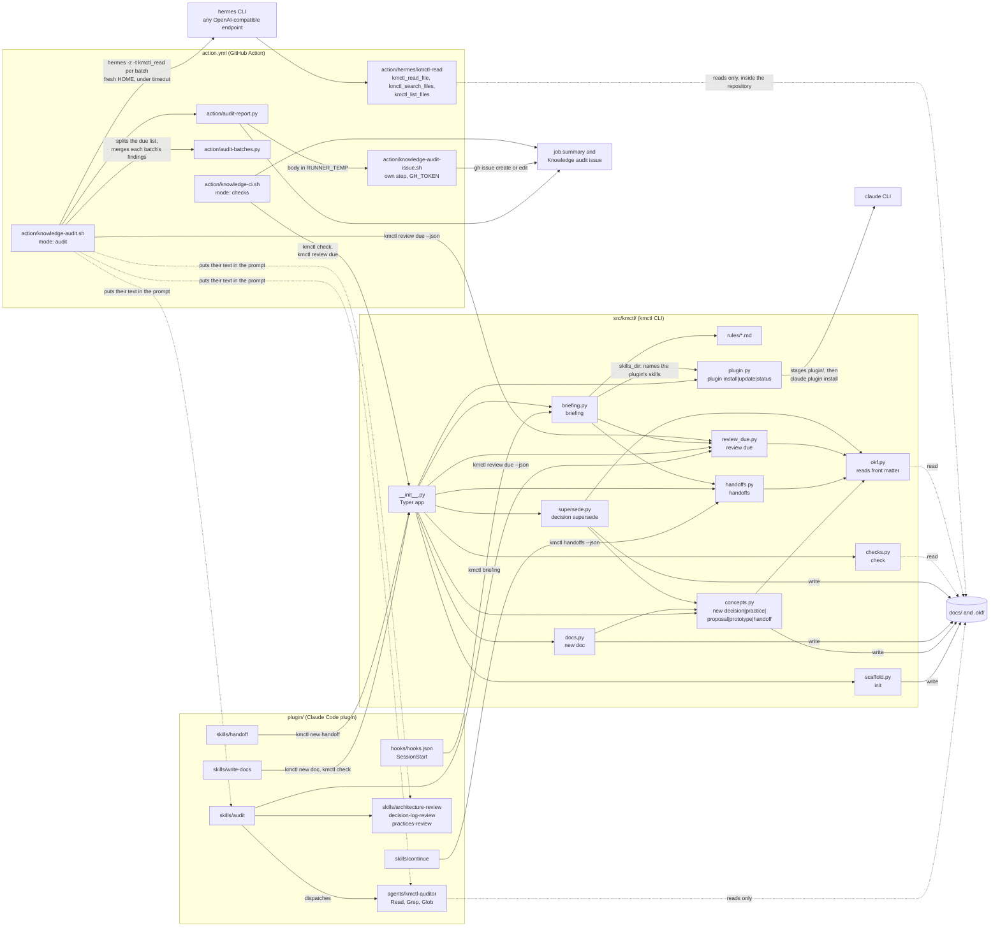

# Architecture overview

kmctl has three parts (manifesto, Parts). The CLI in `src/kmctl/` does every
step a script can do and is the only part that writes knowledge. The plugin
in `plugin/` and the action in `action.yml` and `action/` call the CLI; they
hold no logic of their own beyond relaying it, and the audit they run reads
and reports only.

## The CLI

`src/kmctl/__init__.py` holds the Typer app and only parses, prints and sets
exit codes. Each verb calls one module:

| Verb | Module | Writes |
|---|---|---|
| `kmctl init` | `scaffold.py` | `docs/README.md` and a starter `.okf/`, never touching a file that exists |
| `kmctl check` | `checks.py` | nothing |
| `kmctl briefing` | `briefing.py`, with `review_due.py`, `handoffs.py`, the packaged `rules/`, and `plugin.py` for the skills it names | nothing |
| `kmctl review due` | `review_due.py` | nothing |
| `kmctl handoffs` | `handoffs.py` | nothing |
| `kmctl new decision`, `practice`, `proposal`, `prototype`, `handoff` | `concepts.py` | the concept, its section index entry and a log line |
| `kmctl new doc` | `docs.py` | the page and its `docs/README.md` entry |
| `kmctl decision supersede` | `supersede.py` | both decision records and a log line |
| `kmctl plugin install`, `update`, `status` | `plugin.py` | the staged plugin in `$XDG_DATA_HOME/kmctl/marketplace`, then `claude plugin` installs it |

`okf.py` is the one reader of OKF front matter. `concepts.py`, `handoffs.py`,
`review_due.py` and `supersede.py` read fields through it, so the fields kmctl
uses are the ones the OKF v0.2 spec defines plus `handoff_key` (I4, ADR 0006,
ADR 0009).

## The plugin

The plugin ships inside the kmctl wheel (ADR 0001), so `kmctl plugin install`
always installs the plugin of the same release. It depends on the `okf`
plugin from the scaccogatto marketplace (ADR 0003).

- **One hook.** `hooks/hooks.json` has one SessionStart hook. It runs
  `kmctl briefing` and exits 0 even when kmctl is missing or fails (I1,
  ADR 0004). The briefing is whatever the CLI prints, so upgrading the CLI
  updates it, and its word count has a fixed budget (I3, ADR 0002).
- **Skills route; kmctl writes.** `write-docs`, `handoff` and `continue` call
  `kmctl new doc`, `kmctl new handoff` and `kmctl handoffs`, so the file
  structure always comes from the CLI.
- **The audit reads only.** The `audit` skill takes the due list from
  `kmctl review due --json`, batches it, and dispatches the `kmctl-auditor`
  agent with one of the three review skills. The auditor's tools are Read,
  Grep and Glob (I2, ADR 0005).

## The action

`action.yml` is a composite action with two modes. Both install kmctl from the
action's own checkout.

- **checks** (the default) runs `action/knowledge-ci.sh`: `kmctl check` and
  `kmctl review due` into the job summary, failing when `kmctl check` fails
  or `kmctl review due` crashes, never because a concept is due.
- **audit** (opt-in) runs `action/knowledge-audit.sh`, only on
  `workflow_dispatch` or `schedule`. It filters `kmctl review due --json` to
  architecture, decisions and practices, and runs Hermes Agent against any
  OpenAI-compatible endpoint (ADR 0010). It writes Hermes' config into a
  fresh HOME, installs kmctl's Hermes plugin there, and passes
  `-t kmctl_read`, so the model's only tools are the plugin's
  `kmctl_read_file`, `kmctl_search_files` and `kmctl_list_files`. They are
  plain Python, start no program and refuse any path outside the repository.
  `action/audit-batches.py` splits the due list by kind into batches of at
  most ten, and Hermes runs once per batch. Each prompt carries the audit
  skill, the kmctl-auditor instructions and that kind's review skill as text.
  `timeout` gives each run the time left of one budget for the whole audit.
  `action/audit-batches.py` merges each run's last json block, and
  `action/audit-report.py` turns the merged list into the job summary and an
  issue body (I2). It
  never edits or pushes, and it refuses to start when the model could read a GitHub token
  (`GH_TOKEN` or `GITHUB_TOKEN` set, or checkout's credentials in git config).
  A later step of its own, `action/knowledge-audit-issue.sh`, is the only one
  that gets `GH_TOKEN`; it posts the body to the one "Knowledge audit" issue.

## Depicts

- Invariants: I1 (the SessionStart hook never blocks), I2 (the auditor and
  the action's audit mode read only), I3 (the hook prints `kmctl briefing`),
  I4 (`okf.py` reads OKF fields for every module).
- Verbs: `kmctl init`, `kmctl check`, `kmctl briefing`, `kmctl review due`,
  `kmctl handoffs`, `kmctl new decision`, `kmctl new practice`,
  `kmctl new proposal`, `kmctl new prototype`, `kmctl new handoff`,
  `kmctl new doc`, `kmctl decision supersede`, `kmctl plugin install`,
  `kmctl plugin update`, `kmctl plugin status`.
- Modules: `src/kmctl/__init__.py`, `scaffold.py`, `checks.py`,
  `briefing.py`, `rules/`, `review_due.py`, `handoffs.py`, `concepts.py`,
  `docs.py`, `supersede.py`, `plugin.py`, `okf.py`; `plugin/hooks/hooks.json`,
  `plugin/skills/` (write-docs, handoff, continue, audit and the three review
  skills), `plugin/agents/kmctl-auditor.md`; `action.yml`,
  `action/knowledge-ci.sh`, `action/knowledge-audit.sh`,
  `action/hermes/kmctl-read/`, `action/audit-batches.py`,
  `action/audit-report.py`,
  `action/knowledge-audit-issue.sh`; `.github/workflows/knowledge-audit.yml`.
