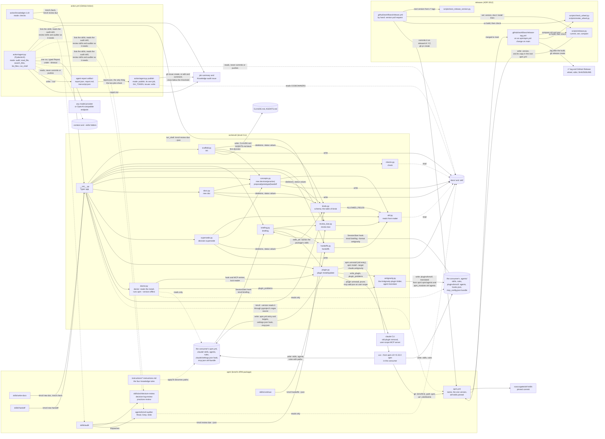

# Architecture overview

kmctl has three parts (manifesto, Parts). The CLI in `src/kmctl/` does every
step a script can do and is the only part that writes knowledge. The APM
package in `apm/` (skills, the audit agent and the knowledge rules) and the
action in `action.yml` and `action/` call the CLI; they hold no logic of
their own beyond relaying it, and the audit they run reads and reports only.
`kmctl plugin install` installs the package with APM and writes the
SessionStart hook and okf's MCP server itself (ADR 0014); for Antigravity it
writes them, with the agents, as the plugin folder `.agents/plugins/kmctl/`
(ADR 0015). `kmctl doctor` reads what an install left, without writing
or using the network, and names each missing or changed piece with its
fix. Releases come from
two workflows and the scripts in `scripts/` (ADR 0012).

## The CLI

`src/kmctl/__init__.py` holds the Typer app and only parses, prints and sets
exit codes. Each verb calls one module:

| Verb | Module | Writes |
|---|---|---|
| `kmctl init`, `kmctl update` (an alias) | `scaffold.py`, with `concepts.py` for the first decision | `docs/README.md`, a starter `.okf/`, the kmctl block in `CLAUDE.md` and `AGENTS.md`, and decision "Keep project knowledge in an OKF bundle"; it keeps every file that exists except for that block and the decision's index entry and log line (ADR 0011). It writes no rules: those come with the package (ADR 0014) |
| `kmctl check` | `checks.py` | nothing |
| `kmctl briefing` | `briefing.py`, with `review_due.py`, `handoffs.py` and `plugin.py` for the skills it names, which the wheel carries as `kmctl/_skills/`; the knowledge rules are in `.claude/rules/`, not the briefing | nothing |
| `kmctl review due` | `review_due.py` | nothing |
| `kmctl handoffs` | `handoffs.py` | nothing |
| `kmctl schema` | `kinds.py`, with `okf.py` for the field names | nothing |
| `kmctl new decision`, `practice`, `proposal`, `prototype`, `handoff` | `concepts.py`, with `okf.py` to find each `--source` the way `review_due.py` does | the concept, its section index entry and a log line; `--stale-after` and `--source` write its `stale_after` and `sources` |
| `kmctl new doc` | `docs.py` | the page and its `docs/README.md` entry |
| `kmctl decision supersede` | `supersede.py` | both decision records and a log line |
| `kmctl plugin install`, `update` | `plugin.py`, with `antigravity.py` for `--harness antigravity` | runs `apm uninstall` on an old apm.yml entry; writes kmctl's entry and `targets:` into `apm.yml`; runs `apm install` through `uvx`; for claude, only once that succeeds removes the old claude plugin `kmctl@kmctl`, then merges one SessionStart hook into `.claude/settings.json` and the `okf-bundle` server into `.mcp.json` (ADR 0014); for antigravity, replaces `.agents/plugins/kmctl/` and deletes APM's copies of kmctl's rules from `.agents/rules/` and its okf Stop handler from `.agents/hooks.json` (ADR 0015, ADR 0016, ADR 0018) |
| `kmctl plugin remove` | `plugin.py`, with `doctor.py` for the harnesses installed and `antigravity.py` for the plugin folder | runs `apm uninstall` on kmctl's apm.yml entry; drops a removed harness from `targets:` when no other dependency is left; takes out the SessionStart hook and `okf-bundle` for claude and `.agents/plugins/kmctl/` for antigravity; installs the kept harnesses again at their ref (ADR 0019) |
| `kmctl doctor` | `doctor.py`, with `plugin.py` for the hook, MCP entries and lock reader and `antigravity.py` for the folder comparison | nothing; it reads `apm.yml`, `apm.lock.yaml` and the files it lists, the settings files, `.mcp.json`, `.agents/plugins/kmctl/` and agy's trust list, and runs only `uv tool run --offline --from apm-cli==0.33.0 apm --version`; `--online` fetches okf's MCP script URL |

`kinds.py` holds the one table of document kinds: each kind's front matter
fields, its status values and its `##` sections. `kmctl new`, `kmctl new doc`,
`kmctl init` and `kmctl decision supersede` take their skeletons, the
manifesto's sections and the status they write from it, and `kmctl schema`
prints a JSON Schema built from it, so the schema is what kmctl writes.

`okf.py` is the one reader of OKF front matter. `concepts.py`, `handoffs.py`,
`review_due.py` and `supersede.py` read fields through it, so the fields kmctl
uses are the ones the OKF v0.2 spec defines plus `handoff_key` (I4, ADR 0006,
ADR 0009).

## The package and its install

The skills, the audit agent and the knowledge rules live in `apm/.apm/`, and
`apm/apm.yml` names the package, carries the one release version and pins
`scaccogatto/okf-skills` (ADR 0014). `kmctl plugin install --harness claude`
writes `{git: SOURCE, path: apm, ref: v<cli version>}` into the repository's
`apm.yml` and runs APM, so the CLI always installs the package of its own
release (ADR 0001). The wheel carries `apm/.apm/skills/`, for the
briefing, and `apm/.apm/agents/` and `apm/.apm/instructions/`, for the
Antigravity translation.

- **One hook, written by kmctl.** `plugin.py` merges one SessionStart hook
  into `.claude/settings.json`, found again by its `kmctl briefing` command.
  It runs `kmctl briefing` and exits 0 even when kmctl is missing or fails
  (I1, ADR 0004). The briefing is whatever the CLI prints, so upgrading the
  CLI updates it, and it has a fixed budget (I3, ADR 0002).
- **okf's MCP server.** APM skips it as a transitive dependency's, so
  `plugin.py` declares `okf-bundle` in `.mcp.json`: `uv run` of
  `okf_mcp.py` at the pinned commit, through an `sh` launcher that walks up
  to the nearest `.okf/`. It keeps an okf server already there under another
  name.
- **Antigravity's plugin folder.** APM writes the skills into `.agents/`
  but no agents or MCP server Antigravity reads, and rules it cannot use,
  so `antigravity.py` writes `.agents/plugins/kmctl/` whole: `plugin.json`,
  `hooks.json` with one SessionStart hook running
  `kmctl briefing --format antigravity` (it prints `{}` and exits 0 when
  kmctl is missing or fails, I1) and one Stop hook running okf's bundle
  check from the repository root in Antigravity's format (ADR 0018), the auditor and okf's two agents
  translated from Claude Code's format, the four rules in `rules/` with
  their globs as one comma-separated string of `**/` globs, and
  `mcp_config.json` with okf's server `bundle` through the same launcher
  (ADR 0015). It then deletes APM's copies of kmctl's rules from
  `.agents/rules/` (ADR 0016) and APM's broken okf Stop handler from
  `.agents/hooks.json` (ADR 0018).
- **Rules as instructions.** Each rule is
  `apm/.apm/instructions/NAME.instructions.md` with an `applyTo:`, which APM
  writes into `.claude/rules/NAME.md` as `paths:`, and `antigravity.py`
  translates into `.agents/plugins/kmctl/rules/NAME.md`.
- **Skills route; kmctl writes.** `write-docs`, `handoff` and `continue` call
  `kmctl new doc`, `kmctl new handoff` and `kmctl handoffs`, so the file
  structure always comes from the CLI.
- **The audit reads only.** The `audit` skill takes the due list from
  `kmctl review due --json`, batches it, and dispatches the `kmctl-auditor`
  agent with one of the three review skills. The auditor's tools are Read,
  Grep and Glob (I2, ADR 0005). In CI, `action/agent.py` does the auditor's
  work itself and also has a shell, but nothing it changes is committed.

## The action

`action.yml` is a composite action with three modes. checks and audit
install kmctl from the action's own checkout.

- **checks** (the default) runs `action/knowledge-ci.sh`: `kmctl check` and
  `kmctl review due` into the job summary, failing when `kmctl check` fails
  or `kmctl review due` crashes, never because a concept is due.
- **audit** (opt-in) runs `action/agent.py` with `uv run --script`: one
  standalone PydanticAI script that does not import kmctl (ADR 0017). Its
  task is the `prompt` input, or by default the knowledge audit: follow the
  audit skill and do the kmctl-auditor's work itself. Its system prompt,
  replaceable with `system_prompt_file`, lists the folders it can read and
  each skill's name and description; it reads a SKILL.md when the skill fits.
  `model` names any PydanticAI provider, or with `base_url` any
  OpenAI-compatible endpoint. Its tools are `read_file`, `search_files` and
  `list_files`, which refuse any path outside the repository and the
  `context` and `skills` folders, and `run_shell`, which runs a command in
  the repository with no API key or GitHub token in its environment. It
  returns a typed report, writes `report.json`, `report.md` and
  `transcript.json` to the `agent-report` artifact and `report.md` to the
  job summary. It never commits or pushes (I2), and it refuses to start
  when a GitHub token is reachable (`GH_TOKEN` or `GITHUB_TOKEN` set, or
  checkout's credentials in git config). setup-uv's cache is off, so
  nothing the agent wrote outlives its job but the artifact.
- **publish** runs in a separate job on a fresh runner, the only one with
  `GH_TOKEN` and `issues: write`. It downloads the artifact and runs
  `action/agent.py publish`: when a finding is at or above `min_severity`
  (default high), it creates the one issue titled `issue_title`, or replaces
  its body and adds a comment, @-mentioning the owners of the last `*` rule
  in CODEOWNERS or the `mention` input; below the threshold it closes an
  open issue with a comment.

## Releases

The version is written once, in `apm/apm.yml`; `pyproject.toml` reads it
with hatchling's `regex` version source, so `kmctl --version`, the package
tag `kmctl plugin install` asks for and a build from a download with no
`.git` agree (ADR 0012, ADR 0014).

- `.github/workflows/release.yml` runs by hand. It works out the version with
  `scripts/next_release_version.py`, refuses a real run off `main` or a tag
  that exists, runs the lint and the tests, and builds and checks the wheel
  with `scripts/check_wheel.py` and `scripts/smoke_wheel.py`. A real run
  commits `scripts/release.py set` (the version in `apm/apm.yml` and its copy
  in the root `apm.yml`, the docs' six install lines and the APM how-to's
  pin) on `release/vX.Y.Z` and opens the version pull request.
- `.github/workflows/release-tag.yml` runs when a push to `main` changes
  `apm/apm.yml`. When `scripts/release.py compare` says the version went up, it
  builds and checks first, then pushes the tag `vX.Y.Z` and publishes the
  GitHub Release with the wheel, the sdist and `SHA256SUMS`. Nothing goes to
  PyPI.

## Depicts

- Invariants: I1 (the SessionStart hook kmctl writes never blocks), I2 (the auditor reads
  only; the action's audit mode never commits or pushes), I3 (the hook prints `kmctl briefing`),
  I4 (`okf.py` reads OKF fields for every module).
- Verbs: `kmctl init`, `kmctl update`, `kmctl check`, `kmctl briefing` (and `--format antigravity`), `kmctl review due`,
  `kmctl handoffs`, `kmctl new decision`, `kmctl new practice`,
  `kmctl new proposal`, `kmctl new prototype`, `kmctl new handoff`,
  `kmctl new doc`, `kmctl schema`, `kmctl decision supersede`, `kmctl plugin install`,
  `kmctl plugin update`, `kmctl plugin remove`, `kmctl doctor`.
- Modules: `src/kmctl/__init__.py`, `scaffold.py`, `checks.py`,
  `briefing.py`, `review_due.py`, `handoffs.py`, `concepts.py`,
  `docs.py`, `supersede.py`, `src/kmctl/plugin.py` (the hook and MCP
  writers), `src/kmctl/antigravity.py` (the Antigravity plugin folder),
  `src/kmctl/doctor.py` (the install checks),
  `okf.py`, `kinds.py`; `apm/.apm/skills/` (write-docs, handoff,
  continue, audit and the three review skills),
  `apm/.apm/agents/kmctl-auditor.md`, `apm/.apm/instructions/`; `action.yml`,
  `action/knowledge-ci.sh`, `action/agent.py` (run and publish); `.github/workflows/knowledge-audit.yml`.
- Releases: `.github/workflows/release.yml`, `.github/workflows/release-tag.yml`,
  `scripts/release.py`, `scripts/next_release_version.py`,
  `scripts/check_wheel.py`, `scripts/smoke_wheel.py`, `apm/apm.yml`.
- APM: `apm/apm.yml` and its pinned `scaccogatto/okf-skills`; the
  consumer's `apm.yml`, `.claude/settings.json` and `.mcp.json`.
