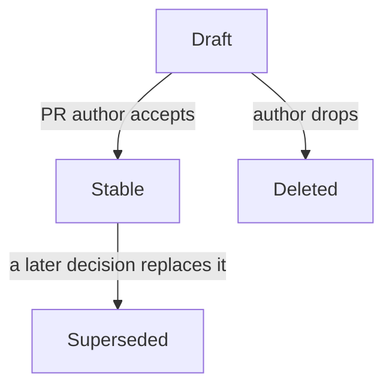
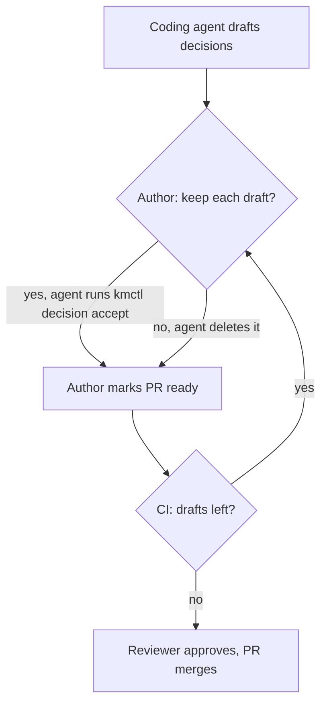
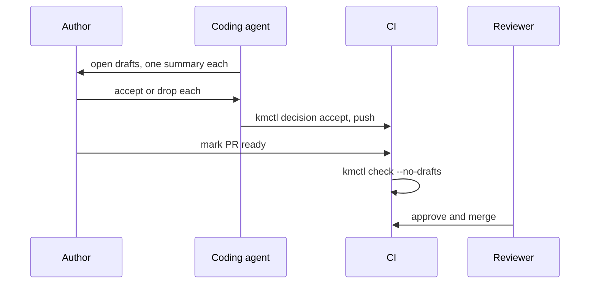

# Who decides a decision record

## The question

In a team that builds with coding agents, the agents write most decision
records. A record says "we chose this", so somebody has to have chosen it.
Before this change, nothing said who. `kmctl check` passed a draft, no verb
accepted one, and in one repository 29 of the 44 decision records that
merged pull requests added were still drafts when they merged.

kmctl answers with one rule: the author decides, their coding agent applies,
and CI enforces.

## How it works

Two parties act. The **author** of the pull request decides. Their **coding
agent**, in the author's local session, runs every kmctl command. CI only
checks.

| Step | Decides | Runs it | Where | How |
|---|---|---|---|---|
| Draft | Coding agent | Coding agent | Local | `kmctl new decision --draft` |
| List open drafts | | Coding agent | Local | `kmctl check --no-drafts` |
| Accept or drop | Author | Coding agent | Local | `kmctl decision accept NUMBER`, or delete the file |
| Mark ready | Author | Author | GitHub | Ready for review |
| Block drafts | | kmctl's action | CI | `kmctl check --no-drafts` |
| Review and merge | Reviewer | Reviewer | GitHub | Normal code review |

A record's status moves like this. Each box is a status; the coding agent
creates every draft.

One pull request, from start to merge. Boxes are actions, diamonds are
questions, and each names who acts. Every agent step ends with a push,
which runs CI again.

The same pull request, read top to bottom by who talks to whom:

## Why it is this way

**A person says yes, and the log says who.** `stable` has to mean somebody
chose it. So only a person accepts (ADR 0050): `kmctl decision accept`
refuses a `--by` that is not `human:<id>`, the knowledge rules tell the agent
to run it only on the author's explicit yes, and CI never runs it. The log
line names the person.

**The author, not the reviewer.** The author was there when the choice was
made and can explain it. A reviewer's approval covers the whole change, not
one record, so kmctl does not count it as accepting a decision.

**Blocked at review, not before.** A draft pull request is where a draft
belongs: the work is still moving. The action's default, `fail-when-ready`,
checks only once the pull request is ready for review. Set `drafts: fail` to
check on every run.

**Not verification.** Accepting answers "did we choose this?" once.
`kmctl verify` answers a different question: does a record still hold, as
the code changes? A person rereads it and confirms (ADR 0023). The two stay
separate verbs.
